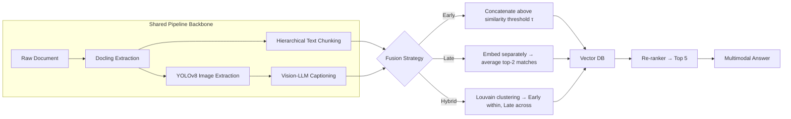

# Fusion of Modalities: Multimodal Retrieval-Augmented Generation

**Comparing Early, Late, and Hybrid Fusion strategies for Multimodal RAG — with two new evaluation frameworks for measuring retrieval and generation quality.**

[]()

[]()

[]()

[]()

> Full write-up: [`Fusion_of_Modalities_and_Evaluation_of_Multimodal_Retrieval_Augmented_Generation.pdf`](https://gitlab.computing.dcu.ie/rudalphvictor.gonsalves2/2026-mcm-ai-practicum/-/tree/main/docs/documentation)

---

## What is this?

Large Language Models hallucinate when asked deep, domain-specific questions — Retrieval-Augmented Generation (RAG) fixes that for text, but most real-world documents aren't just text. They're PDFs full of charts, screenshots, diagrams, and tables sitting next to paragraphs. Standard RAG doesn't know what to do with that.

This project asks a simple question with a surprisingly complicated answer:

> **When you fuse text and image information for retrieval, *when* should you fuse it — before embedding, after embedding, or somewhere in between?**

To find out, we built and benchmarked **three complete M-RAG pipelines**, each identical except for one thing: *how and when modalities are combined*. We then evaluated them with two evaluation frameworks designed specifically for this project, because existing retrieval and generation metrics couldn't tell us what we actually needed to know.

---

## TL;DR Results

| Pipeline | Hit@5 | MRR | Mean Error Point ↓ |
|---|:---:|:---:|:---:|
| **Early Fusion** | 0.9000 | 0.7333 | 0.1975 |
| **Late Fusion** | 0.8462 | 0.8291 | 0.1868 |
| **Hybrid Fusion** | 0.7436 | 0.7308 | 0.2623 |

**Late Fusion wins overall** — the best-ranked, lowest-error retrieval. **Early Fusion** edges it out on raw hit rate, but on a smaller evaluation slice. There's no universal winner: the right pipeline depends on your dataset's structure and modality balance — which is exactly the point of building this comparison framework.

---

## The Three Pipelines

All three pipelines share the same document extraction, chunking, embedding, retrieval, and re-ranking backbone — they only diverge in **when fusion happens**.



### Early Fusion
Text chunks and image descriptions are compared pairwise by cosine similarity. Pairs above a threshold `τ` are **concatenated before embedding** into a single fused unit. Everything else is embedded standalone.

### Late Fusion
Text and images are embedded **independently** (CLIP, shared vector space) and stored in separate collections. Each image is matched to its top-2 most similar text chunks, and fused embeddings are created by **averaging** — stored in a third `fused-only` collection. All three collections stay searchable at query time to avoid losing content that a fusion pass missed.

### Hybrid Fusion
Builds a fully-connected similarity graph over every text chunk and image description, then runs **Louvain community detection**. Nodes in the same cluster get the Early Fusion treatment; nodes in different clusters get the Late Fusion treatment. Best of both worlds — in theory.

---

## How We Measured Success

Standard RAG metrics weren't enough for what we needed to answer, so this project introduces two custom evaluation frameworks.

### Error Point (EP) — a new retrieval metric

MRR and Hit@K tell you *whether* the right chunk was retrieved. They don't tell you **how bad the wrong ones were**. A system that retrieves near-relevant noise is not the same as one that retrieves garbage — but conventional metrics score them identically.

**Error Point** folds in the vector distance of every incorrectly retrieved chunk, weighted by its rank, into a single score:

- **If the correct chunk is retrieved:** rank position rewards the score, while nearby wrong chunks (rank-weighted) penalize it.
- **If the correct chunk is missing entirely:** a penalty multiplier (λ = 1.5) is applied on top of the distance-weighted wrong chunks.

**Lower EP = better retrieval.** It's the first metric (that we're aware of) to jointly capture rank, distance, and total-failure severity in one number.

### Chunk-Weighted Generation Fidelity (CWGF)

BLEU/ROUGE-style scoring treats generation quality as one static number and can't tell you *why* an answer was bad — was it weak retrieval, or a weak model?

CWGF generates **five answers per question**, each using only the top-*k* retrieved chunks (k = 1 → 5), scores each with a composite of cosine similarity + BERTScore + LLM-as-judge, and plots the result as an **ablation curve**. The pipeline's actual answer is then plotted against that curve:

- Near the top (`A5`) → the pipeline is using retrieved context well.
- Below the bottom (`A1`) → generation-level failure, independent of retrieval.
- Ground truth chunk missing from top-5 entirely → retrieval-level failure, flagged separately.

This separates *"the model failed"* from *"the retriever failed"* — a diagnosis existing frameworks can't make.

---

## Evaluation Dataset

Rather than relying on an off-the-shelf benchmark, the evaluation set was generated **from the 22 papers reviewed in this project's own literature review** — each source chunk was passed to an LLM to generate a grounded `(Question, Answer, Chunk, Chunk ID)` tuple, giving a dataset with verifiable ground truth per question.

---

## Repository Structure

```
.
├── Early Fusion/
│   └── Early Fusion Draft 1.ipynb
│   └── Early Fusion Draft 2.ipynb
│   └── Early Fusion Draft 3.ipynb
│   └── Early Fusion Final.ipynb
│       
├── Hybrid Fusion/
│   └── Hybrid Fusion Draft 1.ipynb
│   └── Hybrid Fusion Final.ipynb
│                 
├── Late Fusion/
│   └── Late Fusion Draft 1.ipynb
│   └── Late Fusion Final.ipynb
│      
├── Docs/
│   └── Documentation/
│         └── Fusion of Modalities and Evaluation of Multimodal Retrieval-Augmented Generation.pdf
│
├── Proposal/
│   └── Proposal.pdf
│
├── Literature Review/
│   └── Fusion of Modalities and Evaluation of Multimodal Retrieval-Augmented Generation.pdf
│   
└── README.md
```

> Adjust this tree to match your actual folder layout before committing.

---

## Getting Started

```bash

# Clone the repo
git clone https://gitlab.computing.dcu.ie/rudalphvictor.gonsalves2/2026-mcm-ai-practicum

# Install Dependencies
pip install jupyter

# Early Fusion
cd Early Fusion
jupyter nbconvert --to notebook --execute "Early Fusion/Early Fusion Final.ipynb" --output "Early_Fusion_Output.ipynb"

# Hybrid Fusion
cd Late Fusion
jupyter nbconvert --to notebook --execute "Hybrid Fusion/Hybrid Fusion Final.ipynb" --output "Hybrid_Fusion_Output.ipynb"

# Late Fusion
cd Hybrid Fusion
jupyter nbconvert --to notebook --execute "Late Fusion/Late Fusion Final.ipynb" --output "Late_Fusion_Output.ipynb"

```
---

## Tech Stack

| Component | Tool |
|---|---|
| Document extraction | Docling |
| Image detection | YOLOv8 |
| Image captioning | Vision-Language Model |
| Embeddings | CLIP (shared text–image space for Late/Hybrid) |
| Vector database | Chroma DB |
| Clustering (Hybrid) | Louvain community detection |
| Image placement | Bipartite matching via Edmonds' Blossom algorithm |

---

## Authors

**Rudalph Victor Gonsalves** — [rudalphvictor.gonsalves2@mail.dcu.ie](mailto:rudalphvictor.gonsalves2@mail.dcu.ie)
**Shruti Sudhir Patil** — [shrutisudhir.patil2@mail.dcu.ie](mailto:shrutisudhir.patil2@mail.dcu.ie)

Department of Computing, Dublin City University

## Citation

If you use this work, please cite:

```bibtex
@techreport{gonsalves2026fusion,
  title       = {Fusion of Modalities and Evaluation of Multimodal Retrieval-Augmented Generation},
  author      = {Gonsalves, Rudalph Victor and Patil, Shruti Sudhir},
  institution = {Dublin City University},
  year        = {2026},
  note        = {Unpublished manuscript}
}
```

---

## Key Takeaway

There is no single "best" M-RAG architecture — **Late Fusion led on ranking quality, Early Fusion led on raw hit rate**, and the right choice depends on how your data is structured. This repo gives you the pipelines, the metrics, and the dataset to make that call for your own use case.


<!-- # 2026-mcm-ai-practicum


## Getting started

To make it easy for you to get started with GitLab, here's a list of recommended next steps.

Already a pro? Just edit this README.md and make it your own. Want to make it easy? [Use the template at the bottom](#editing-this-readme)!

## Add your files

- [ ] [Create](https://docs.gitlab.com/ee/user/project/repository/web_editor.html#create-a-file) or [upload](https://docs.gitlab.com/ee/user/project/repository/web_editor.html#upload-a-file) files
- [ ] [Add files using the command line](https://docs.gitlab.com/topics/git/add_files/#add-files-to-a-git-repository) or push an existing Git repository with the following command:

```
cd existing_repo
git remote add origin https://gitlab.computing.dcu.ie/rudalphvictor.gonsalves2/2026-mcm-ai-practicum.git
git branch -M main
git push -uf origin main
```

## Integrate with your tools

- [ ] [Set up project integrations](https://gitlab.computing.dcu.ie/rudalphvictor.gonsalves2/2026-mcm-ai-practicum/-/settings/integrations)

## Collaborate with your team

- [ ] [Invite team members and collaborators](https://docs.gitlab.com/ee/user/project/members/)
- [ ] [Create a new merge request](https://docs.gitlab.com/ee/user/project/merge_requests/creating_merge_requests.html)
- [ ] [Automatically close issues from merge requests](https://docs.gitlab.com/ee/user/project/issues/managing_issues.html#closing-issues-automatically)
- [ ] [Enable merge request approvals](https://docs.gitlab.com/ee/user/project/merge_requests/approvals/)
- [ ] [Set auto-merge](https://docs.gitlab.com/user/project/merge_requests/auto_merge/)

## Test and Deploy

Use the built-in continuous integration in GitLab.

- [ ] [Get started with GitLab CI/CD](https://docs.gitlab.com/ee/ci/quick_start/)
- [ ] [Analyze your code for known vulnerabilities with Static Application Security Testing (SAST)](https://docs.gitlab.com/ee/user/application_security/sast/)
- [ ] [Deploy to Kubernetes, Amazon EC2, or Amazon ECS using Auto Deploy](https://docs.gitlab.com/ee/topics/autodevops/requirements.html)
- [ ] [Use pull-based deployments for improved Kubernetes management](https://docs.gitlab.com/ee/user/clusters/agent/)
- [ ] [Set up protected environments](https://docs.gitlab.com/ee/ci/environments/protected_environments.html)

***

# Editing this README

When you're ready to make this README your own, just edit this file and use the handy template below (or feel free to structure it however you want - this is just a starting point!). Thanks to [makeareadme.com](https://www.makeareadme.com/) for this template.

## Suggestions for a good README

Every project is different, so consider which of these sections apply to yours. The sections used in the template are suggestions for most open source projects. Also keep in mind that while a README can be too long and detailed, too long is better than too short. If you think your README is too long, consider utilizing another form of documentation rather than cutting out information.

## Name
Choose a self-explaining name for your project.

## Description
Let people know what your project can do specifically. Provide context and add a link to any reference visitors might be unfamiliar with. A list of Features or a Background subsection can also be added here. If there are alternatives to your project, this is a good place to list differentiating factors.

## Badges
On some READMEs, you may see small images that convey metadata, such as whether or not all the tests are passing for the project. You can use Shields to add some to your README. Many services also have instructions for adding a badge.

## Visuals
Depending on what you are making, it can be a good idea to include screenshots or even a video (you'll frequently see GIFs rather than actual videos). Tools like ttygif can help, but check out Asciinema for a more sophisticated method.

## Installation
Within a particular ecosystem, there may be a common way of installing things, such as using Yarn, NuGet, or Homebrew. However, consider the possibility that whoever is reading your README is a novice and would like more guidance. Listing specific steps helps remove ambiguity and gets people to using your project as quickly as possible. If it only runs in a specific context like a particular programming language version or operating system or has dependencies that have to be installed manually, also add a Requirements subsection.

## Usage
Use examples liberally, and show the expected output if you can. It's helpful to have inline the smallest example of usage that you can demonstrate, while providing links to more sophisticated examples if they are too long to reasonably include in the README.

## Support
Tell people where they can go to for help. It can be any combination of an issue tracker, a chat room, an email address, etc.

## Roadmap
If you have ideas for releases in the future, it is a good idea to list them in the README.

## Contributing
State if you are open to contributions and what your requirements are for accepting them.

For people who want to make changes to your project, it's helpful to have some documentation on how to get started. Perhaps there is a script that they should run or some environment variables that they need to set. Make these steps explicit. These instructions could also be useful to your future self.

You can also document commands to lint the code or run tests. These steps help to ensure high code quality and reduce the likelihood that the changes inadvertently break something. Having instructions for running tests is especially helpful if it requires external setup, such as starting a Selenium server for testing in a browser.

## Authors and acknowledgment
Show your appreciation to those who have contributed to the project.

## License
For open source projects, say how it is licensed.

## Project status
If you have run out of energy or time for your project, put a note at the top of the README saying that development has slowed down or stopped completely. Someone may choose to fork your project or volunteer to step in as a maintainer or owner, allowing your project to keep going. You can also make an explicit request for maintainers. -->
